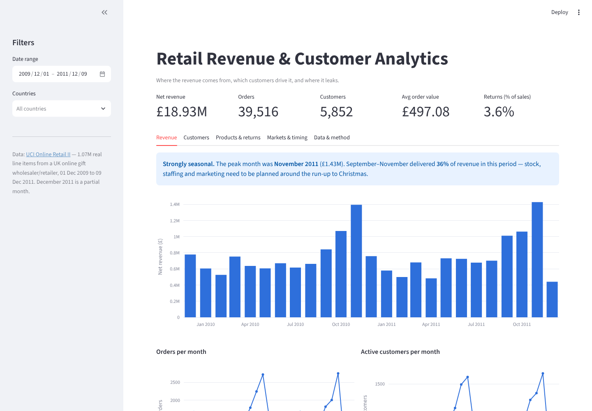
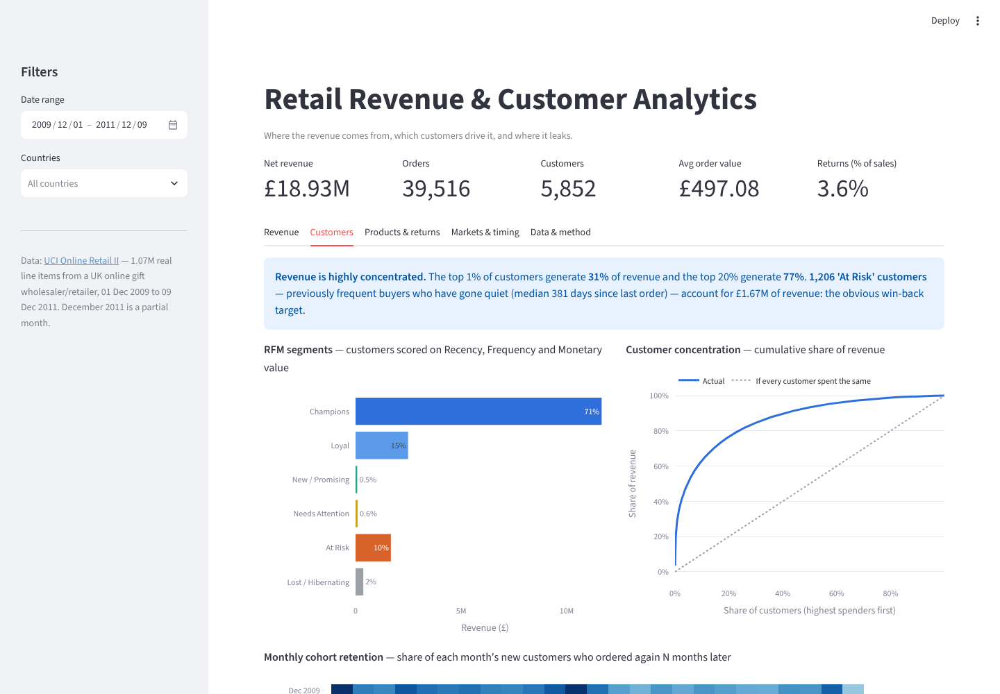
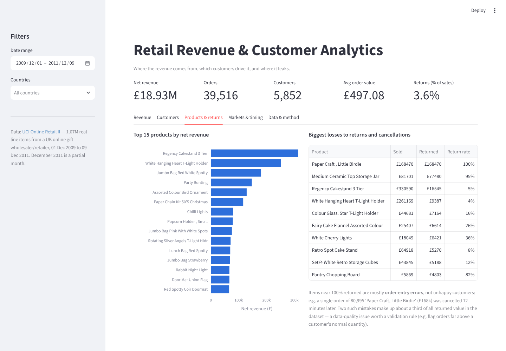

# Retail Revenue & Customer Analytics

An interactive analytics dashboard built on **1.07 million real transactions** from a UK online gift retailer
([UCI Online Retail II](https://archive.ics.uci.edu/dataset/502/online+retail+ii), Dec 2009 – Dec 2011).
It answers four business questions: *where does revenue come from, which customers drive it, are we keeping
them, and where is money leaking?*

**Stack:** Python · SQL (DuckDB) · pandas · Streamlit · Plotly · pytest · GitHub Actions



## Key findings

| # | Finding | Why it matters |
|---|---------|----------------|
| 1 | **The top 1% of customers generate 31% of revenue; the top 20% generate 77%.** RFM "Champions" (27% of customers) account for 71%. | Losing a handful of key accounts would hit revenue hard — they need account management, not generic marketing. |
| 2 | **1,206 "At Risk" customers** — previously regular buyers, median 381 days since their last order — represent **£1.67M** of past revenue. | The clearest win-back target in the business: re-activating even 10% of them at their past spend would recover roughly £170k. |
| 3 | **Only ~21% of new customers order again the next month**, and 28% of customers only ever ordered once. | Acquisition isn't turning into repeat business; a second-order incentive is likely the cheapest growth lever. |
| 4 | **September–November brings in 37.5% of annual revenue**, and full-year revenue grew only 1.9% (Dec 2010–Nov 2011 vs. the previous 12 months). | Stock, staffing and cash flow must be planned around the pre-Christmas peak; the business is flat outside it. |
| 5 | **Returns are 3.6% of sales, but a third of the returned value comes from just two order-entry errors** (e.g. 80,995 units of one item, £168k, cancelled 12 minutes later). | A data-quality issue, not a customer one — a simple rule flagging orders far above a customer's usual quantity would catch it. Treating it as "returns" would mislead product decisions. |
| 6 | **85% of revenue is from the UK; almost no orders are placed on Saturdays**, with a weekday-lunchtime peak. EIRE is 3% of revenue from just 3 customers. | A B2B (wholesale) customer base: plan support hours and campaigns around the working week, and watch export-market concentration. |

All figures are for the full date range. Every finding updates live as you change the date and country filters.

## What's in the dashboard

| Tab | Shows |
|-----|-------|
| **Revenue** | Net revenue, orders and active customers per month; KPIs compared with the previous period of equal length |
| **Customers** | RFM segmentation, customer-concentration (Pareto) curve, monthly cohort-retention heatmap |
| **Products & returns** | Top products by net revenue; products losing the most to returns/cancellations |
| **Markets & timing** | Revenue by country; order volume by weekday × hour |
| **Data & method** | Data source, metric definitions and a row-by-row cleaning report |

| Customers | Products & returns |
|---|---|
|  |  |

## How it works

```
UCI raw Excel (1,067,371 rows)
        │  etl/build_dataset.py   download → clean → validate
        ▼
data/transactions.parquet (1,021,128 rows) + data/cleaning_report.json
        │  analytics.py           load into in-memory DuckDB
        ▼
sql/*.sql                         all business logic, one query per question
        │
        ▼
app.py                            Streamlit layout + Plotly charts only
```

- **The analysis is in SQL**, not hidden in pandas: CTEs, window functions (`CUME_DIST`, `FIRST_VALUE`,
  running sums), `FILTER` clauses and a DuckDB table macro that applies the dashboard filters. Each file in
  [`sql/`](sql) answers one question and can be read on its own.
- **Cleaning is documented and measured.** [`etl/build_dataset.py`](etl/build_dataset.py) removes duplicates,
  non-product lines (postage, fees, manual adjustments), zero-price rows and bad-debt adjustments, and writes
  how many rows each rule removed to [`data/cleaning_report.json`](data/cleaning_report.json).
- **Tested.** Every query is checked against a small hand-built dataset with known answers (KPIs, filter
  boundaries, cohort maths, RFM tie handling, Pareto curve), plus a smoke test that renders the dashboard on
  the real data. CI runs on every push.

### Definitions

- **Net revenue** = sales minus returns and cancellations (invoices prefixed `C`).
- **Return rate** = value returned ÷ value sold.
- **Customers** counts identified customers only. Guest checkouts (no customer ID, ~14% of revenue) count
  towards revenue but not customer metrics.
- **RFM**: each customer gets a 1–5 score on Recency (days since last order), Frequency (number of orders)
  and Monetary value (net spend), using quintiles where tied customers share a score. Score combinations map
  to six segments (Champions, Loyal, New/Promising, Needs Attention, At Risk, Lost/Hibernating).

## Run it locally

```bash
git clone https://github.com/BismarkA17/business-revenue-dashboard.git
cd business-revenue-dashboard
pip install -r requirements.txt
streamlit run app.py
```

The cleaned dataset (7 MB Parquet) is included, so the app runs straight away. To rebuild it from the raw
source and run the tests:

```bash
pip install -r requirements-dev.txt
python etl/build_dataset.py   # downloads ~45 MB from UCI, takes ~2 minutes
pytest -q
```

## Limitations

- The data ends on 9 Dec 2011, so December 2011 is a partial month.
- The first cohort (Dec 2009) looks unusually loyal because it includes existing customers whose earlier
  orders pre-date the dataset.
- Revenue is in GBP at the prices recorded; there is no cost data, so this measures revenue, not profit.

## Project history

- **v1 (Jan 2026):** a Streamlit prototype on randomly generated sales data, with three KPIs and one chart.
  Because the data was random, the filters couldn't show any real differences and there were no findings to
  report.
- **v2 (Oct 2026):** rebuilt on real data with an ETL pipeline, a SQL analysis layer, customer analytics
  (RFM, cohorts, concentration), tests and CI.

Data: Chen, D. (2019). *Online Retail II* [Dataset]. UCI Machine Learning Repository. CC BY 4.0.
